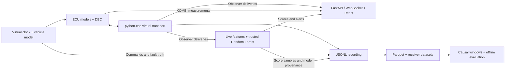

# AutoCAN Studio

**[AutoCAN Studio v2.0.0 release](https://github.com/cryptoadya/autocan-studio/releases/tag/v2.0.0)**

AutoCAN Studio is a local lab for simulating Controller Area Network (CAN) traffic, injecting faults, evaluating detectors offline, and inspecting live anomaly scores.

Repeat a vehicle-network failure under controlled conditions, inspect what each receiver could observe, and compare detectors against known fault intervals. DemoCar uses synthetic physics and original DBC profiles for experimentation without vehicle hardware. Real-vehicle diagnostics are outside its scope.

[](docs/images/m6-fault-scenarios.png)

*Fault lab during playback of a synthetic RPM spike. [Watch the live ML demo](docs/images/m11-live-ml.webm) · [Train and run it from a clean clone](docs/LIVE_DEMO.md)*

## Quick start

Install **Python 3.12**, **uv 0.13.6**, and **Node.js 22.12+ with npm**.

```sh
git clone https://github.com/cryptoadya/autocan-studio.git
cd autocan-studio
uv run --locked autocan studio
```

Open [http://127.0.0.1:8000](http://127.0.0.1:8000). The launcher builds the React dashboard and serves it with FastAPI from the same loopback origin. No API keys or CAN hardware are required.

Choose **ABS missing frames** under **Fault scenarios**, then **Run scenario**. Load the saved run and seek through the outage to see wheel-speed freshness change while engine RPM remains fresh. **Deterministic rerun** recomputes the run and checks its canonical events and final state.

Run the Python tests from the repository root.

```sh
uv run --locked pytest
```

See the [getting started guide](docs/GETTING_STARTED.md) for headless commands and frontend tests. The [live ML demo](docs/LIVE_DEMO.md) trains its own model from seeded synthetic runs.

## What you can do

| Surface | Capabilities |
| --- | --- |
| **Dashboard** | Drive a simulated vehicle, inspect decoded CAN frames and per-message freshness, inject faults or run built-in scenarios, and save, seek through, or recompute a recording. |
| **Headless CLI** | Run seeded JSON scenarios on an integer virtual clock. Record, verify, replay, and rerun them. Exchange traces through Parquet and generate collections across six driving modes with separate fault labels. |
| **Live ML** | Score DemoCar network sessions with a trusted local Random Forest, compare alert and fault tracks, and seek through recorded scores. |
| **Offline research** | Build causal feature windows, compare three fixed rules with two scikit-learn models, and evaluate saved scores for window accuracy, fault detection, false alarms, uncertainty, and inference performance. |

Five electronic control units (ECUs) exchange messages in the network profile. They represent the engine, ABS/DSC, transmission, body, and instrument cluster (KOMBI). Eight DBC-defined messages travel through a virtual bus with receiver-specific delivery. Faults can suppress publication, drop or delay messages, change their rate, or perturb encoded signals.

## Architecture



The simulator owns physics and scheduling. ECU models receive narrow sensor or actuator interfaces and their own CAN deliveries. KOMBI derives measurements and freshness from its received CAN stream. Recording keeps applied commands and fault truth separate from observations. Playback reads saved events, while rerun executes the simulation again from the recorded configuration and commands.

## Machine learning and evaluation

The offline evaluation compares three fixed rules, Isolation Forest, and Random Forest on synthetic CAN traffic. The frozen Random Forest produced **10 false-alarm episodes in 45.6 seconds** of unfamiliar normal driving. [Evaluation methodology, full results, and provenance](docs/ML_EVALUATION.md)

## Limitations

- DemoCar uses synthetic classic CAN and simplified straight-line vehicle dynamics. The transport omits wire arbitration and physical bus behavior.
- Studio serves one local simulation at a time, with bounded recordings and display buffers. Virtual-time determinism provides no wall-clock real-time guarantee.
- Detector training runs offline on synthetic data. Live scoring uses a trusted local Random Forest with a validation-selected threshold.
- The Python wheel provides the CLI and simulator. The dashboard runs from a source checkout with a local frontend build.

## Documentation

- [Getting started](docs/GETTING_STARTED.md) — dashboard, headless recording, and tests
- [Architecture](docs/ARCHITECTURE.md) — scheduling, ECU boundaries, and the local API
- [Simulation and faults](docs/SIMULATION.md) — profiles, scenarios, and fault semantics
- [Trace and dataset formats](docs/DATA_FORMATS.md) — JSONL, Parquet, observer data, and generated collections
- [ML evaluation](docs/ML_EVALUATION.md) — methods, measured results, and reproducibility
- [M1 Studio performance baseline](docs/benchmarks/m1-studio-2026-11-06/) — live M9 scoring, duration-limit recording, and playback

## Roadmap

Potential next steps include broader synthetic evaluation across normal driving regimes and a packaged dashboard distribution. See the [roadmap](docs/ROADMAP.md) for scope and status.

[Changelog](CHANGELOG.md) · [MIT license](LICENSE)
