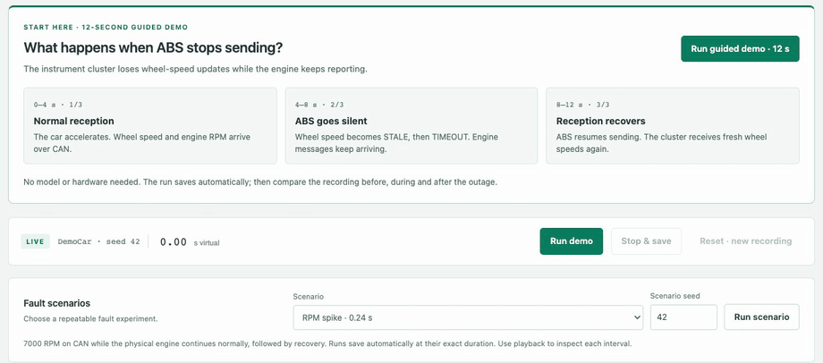
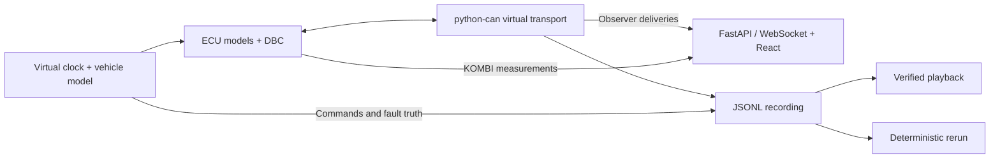

# AutoCAN Studio

AutoCAN Studio is a portfolio project for simulating how vehicle control units communicate over the Controller Area Network (CAN). Working on cars is a hobby of mine, and this project brings that interest into software.

In the guided demo, the ABS unit stops sending messages. The instrument cluster loses wheel-speed updates while engine RPM stays fresh. The run saves automatically for playback.



Playback compares **2 s** before the outage, **6 s** during the outage, and **10 s** after recovery. [Watch the 28-second recording (MP4)](docs/images/abs-guided-demo.mp4)

## Quick start

Install **Python 3.12**, **uv 0.13.6**, and **Node.js 22.12+ with npm**.

```sh
git clone https://github.com/cryptoadya/autocan-studio.git
cd autocan-studio
uv run --locked autocan studio
```

Open [http://127.0.0.1:8000](http://127.0.0.1:8000). The first launch installs the frontend dependencies and builds the React dashboard. Later launches reuse them when they are up to date. No API keys or CAN hardware are required.

1. Click **Run guided demo · 12 s**. The car accelerates, ABS stops publishing at 4 s, and reception resumes at 8 s.
2. When the run saves, click **Inspect outage · 6 s**. The wheel-speed value stays on screen as the last received reading, marked `TIMEOUT`. Engine RPM is still `FRESH`.
3. Use **Before outage · 2 s** and **After recovery · 10 s** to compare the recording. In **Recordings**, click **Deterministic rerun** to verify that a new simulation produces the same events and final state.

The guided demo runs with the default setup. For other scenarios, headless commands, and frontend tests, see the [getting started guide](docs/GETTING_STARTED.md).

Run the Python tests from the repository root.

```sh
uv run --locked pytest
```

## How it works

Five simulated control units exchange eight messages defined in an original DBC profile, which describes how signals are encoded in CAN frames. Python runs the simulation and `python-can` provides the virtual bus. FastAPI serves the React and TypeScript dashboard and streams updates over WebSocket.



- **Virtual time.** The simulator defines the order of events that share a timestamp. Live mode and the headless CLI both use the same simulation clock.
- **Receiver view.** The instrument cluster gets its speed and RPM from CAN deliveries. Its freshness timers can expire when messages stop while the vehicle simulation keeps running.
- **Record and verify.** Playback shows saved observations at a selected time. Rerun starts a new simulation with the recorded configuration and commands, then compares events and final state.

## Machine learning and evaluation

The CLI can generate synthetic datasets with separate fault labels and export traces to Parquet. The offline experiment compares three fixed rules, Isolation Forest, and Random Forest. The frozen Random Forest produced **10 false-alarm episodes in 45.6 seconds** of unfamiliar normal driving. The [evaluation report](docs/ML_EVALUATION.md) documents the sample size and how the metrics were measured. A separate [live scoring demo](docs/LIVE_DEMO.md) trains a local model and displays its alerts alongside injected faults.

## Limitations

- DemoCar uses synthetic classic CAN and simplified straight-line vehicle dynamics. The transport omits wire arbitration and physical bus behavior.
- Studio serves one local simulation at a time, with bounded recordings and display buffers. Virtual-time determinism provides no wall-clock real-time guarantee.
- Detector training runs offline on synthetic data. Live scoring uses a trusted local Random Forest with a validation-selected threshold.
- The Python wheel provides the CLI and simulator. The dashboard runs from a source checkout with a local frontend build.

## Documentation

- [Getting started](docs/GETTING_STARTED.md) — dashboard, headless recording, and tests
- [Architecture](docs/ARCHITECTURE.md) — scheduling, ECU boundaries, and the local API
- [Simulation and faults](docs/SIMULATION.md) — profiles, scenarios, and fault semantics
- [Trace and dataset formats](docs/DATA_FORMATS.md) — JSONL, Parquet, observer data, and generated collections
- [ML evaluation](docs/ML_EVALUATION.md) — methods, measured results, and reproducibility
- [M1 Studio performance baseline](docs/benchmarks/m1-studio-2026-11-06/) — live M9 scoring, duration-limit recording, and playback

## Roadmap

Potential next steps include broader synthetic evaluation across normal driving regimes and a packaged dashboard distribution. See the [roadmap](docs/ROADMAP.md) for scope and status.

[v2.0.0 release](https://github.com/cryptoadya/autocan-studio/releases/tag/v2.0.0) · [Changelog](CHANGELOG.md) · [MIT license](LICENSE)
