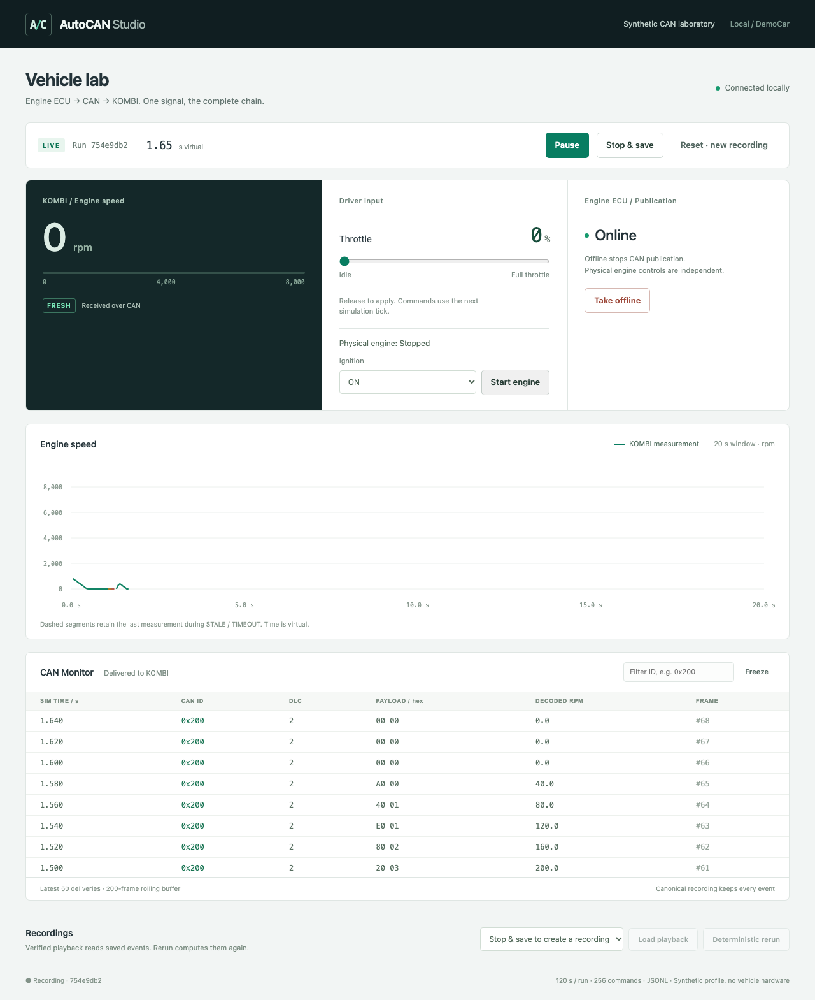
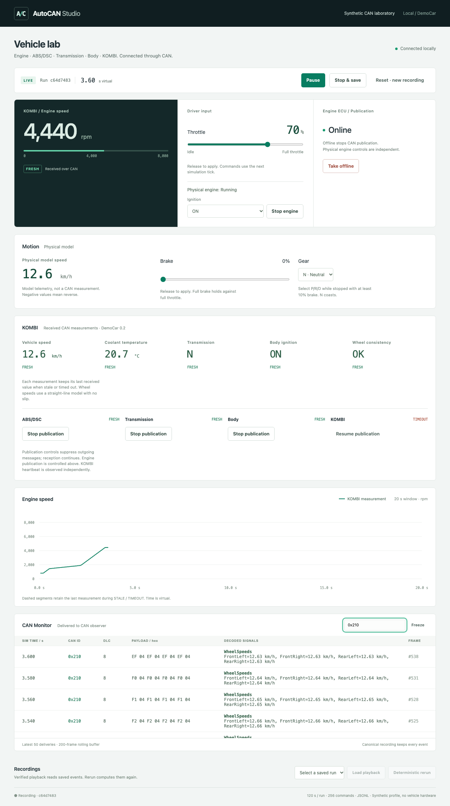
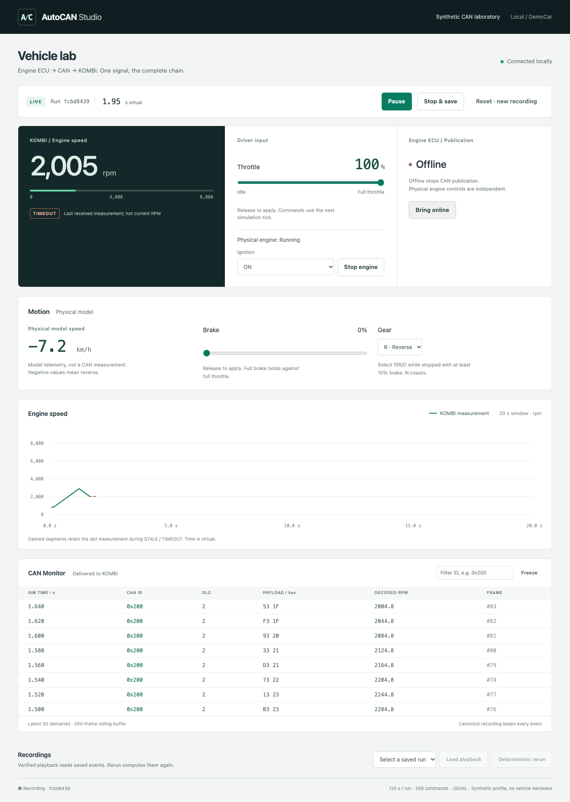

# AutoCAN Studio

A local-first, synthetic CAN laboratory with a deterministic simulator and an
independent anomaly-detection pipeline planned for later milestones.

**M7 implemented and locally verified; released baseline: v0.1.0 (M0–M4).**
Engine, ABS/DSC, Transmission, Body and KOMBI exchange eight synthetic messages
through an in-process python-can adapter. KOMBI decodes received RPM, speed,
temperature, gear and ignition with independent freshness timers. Physical
ignition/Start/Stop, throttle/brake/gear and publication controls are recorded;
runs can be saved, played back and recomputed. The normal urban drive exercises
all five ECU. This is a synthetic laboratory, not an OEM emulator or a physical
vehicle diagnostic tool. The headless network fault library now provides eight
fault types, three reproducible demonstrations and recorded manual inject/clear
commands. The dashboard runs those scenarios, edits fault parameters and restores
active faults and a bounded timeline in live and playback views. The headless CLI
exports/imports verified Parquet runs and builds a selected receiver's raw CAN
dataset with physically separate fault labels. Dataset Factory generates six
seeded driving modes and bounded collections of normal/fault runs with a verified
manifest. ML remains later work. See [fault scenarios](docs/FAULTS.md),
[Parquet exchange](docs/PARQUET.md) and [Dataset Factory](docs/DATASET_FACTORY.md).
The [M7 acceptance report](docs/M7_ACCEPTANCE.md) records the completed checks,
full collection round trips/reruns and current browser regression evidence.
The first M8 headless pass adds [causal windows and Tier 0 alerts](docs/BASELINES.md)
over these observer datasets: heartbeat timeout, RPM derivative and wheel-speed
disagreement. The [second M8 pass](docs/BENCHMARK.md) freezes whole-run/group
splits and benchmarks those fixed rules with episode detection, latency and
false alarms/hour on normal runs. The [third M8 pass](docs/OOD.md) evaluates
separate held-out fault-type and normal-family sets against a frozen ID reference,
without tuning thresholds on OOD. [M9 preparation](docs/TRAINING_DATA.md) exports
aligned numeric windows and separate labels with mode/type group stratification
and train-only imputation/scaling. The [common M9 window evaluator](docs/WINDOW_EVALUATION.md)
adds precision/recall/F1, AP/PR and binary confusion counts through one score
contract for rules and future models. Model training and broader validation
remain later work. [Saved-window loading and `evaluate-rules`](docs/SAVED_WINDOW_RULES.md)
validate preparation artifacts against their original collection and evaluate
the rules on the already saved splits without fitting or tuning.

## Run the dashboard

Install Python 3.12, [uv 0.13.6](https://docs.astral.sh/uv/getting-started/installation/)
and Node.js 22.12+ with npm. From a fresh source checkout:

```sh
git clone https://github.com/cryptoadya/autocan-studio.git
cd autocan-studio
uv run --locked autocan studio
```

Open [AutoCAN Studio](http://127.0.0.1:8000). This command installs the locked
frontend dependencies, builds the UI, and serves it with FastAPI on the same
local origin. No API keys or CAN hardware are needed. Use `--port 8001` to choose
another local port. The launcher requires a source checkout; the Python wheel
still provides the headless CLI/API but does not bundle the frontend.

1. Click **Run demo**, move **Throttle**, then release it to apply the command.
2. Click **Take offline**: the received RPM is retained, then marked **STALE** and
   **TIMEOUT**. **Bring online** resumes publication. Offline leaves the physical
   engine state unchanged.
3. **Pause** freezes virtual time. Commands entered while paused apply when resumed.
4. **Stop & save** finalizes the recording in ignored `data/runs/<run-id>/`.
5. Select the saved run, **Load playback**, and seek through saved virtual time.
   Playback disables live controls and pauses any active simulation.
6. **Deterministic rerun** starts a fresh headless computation and reports whether
   canonical events and the final state match. **Return to live** restores the live
   view; **Reset · new recording** saves the current run and creates a fresh one.

Use **Stop engine** to stop the physical engine: measured RPM coasts toward zero
while Engine ECU keeps publishing, so zero remains **FRESH**. **Start engine**
turns ignition ON and restarts it. Ignition OFF/ACC stops the engine; ON alone
does not start it; START is a momentary synthetic request that returns to ON.
Physical engine state is explicitly labelled separately from received CAN RPM.
These controls also work while Engine ECU is offline; KOMBI refreshes only when
CAN publication resumes.



To drive, apply at least 10% **Brake**, select **D**, then release the brake and
increase throttle. **N** coasts; full brake stops and holds against full throttle.
Wait for the actual gear selection before releasing the brake: the request
travels through Body's CAN message and Transmission requires fresh inputs.
Select P/R/D only while stopped with brake applied; unsafe requests are reported
without interrupting the run. **R** produces negative signed speed. The separate
**Motion / Physical model** panel shows model speed, not a received CAN signal.
KOMBI RPM remains CAN-only and can be stale while the model is moving.

The **KOMBI / Received CAN measurements** panel shows speed, coolant temperature,
gear, Body ignition and wheel consistency. Each field retains its last CAN value
when its own message becomes STALE or TIMEOUT. **Stop publication** independently
suppresses each ECU's outgoing messages; reception continues. Stopping ABS/DSC
publication times out speed while Engine RPM stays fresh. The CAN Monitor uses
a separate observer and decodes all eight messages. Wheel speeds are equal in
the current straight-line model; this does not model wheel slip or real ABS control.





The dashboard uses KOMBI RPM, including when its last observation is stale. It
never substitutes physical model RPM. A reload or WebSocket reconnect restores
state and rolling history from a new snapshot. **Freeze** only freezes the CAN
Monitor display; the simulation and recording continue.

One active simulation is supported. Each API run starts paused and is recorded
from time zero, including manual inputs. Limits: 120 virtual seconds, 256 input
commands, 16 MiB per recording and 64 entries under `data/runs/`. Duration limits
save automatically; recording failures stop the run visibly, and command quotas
reject additional inputs explicitly. Stop and
archive local runs manually to free capacity; the app never deletes them.
The backend/frontend keep at most 200 deliveries and 400 graph points; the table
renders the latest 50 rows. Live updates are capped at 20 Hz. Under load wall-clock
execution may slow; integer virtual time and core calculations remain unchanged.
No real-time performance guarantee is claimed. Local v0.1 acceptance, its scope
and reproducible commands are recorded in [the acceptance report](docs/V0_1_ACCEPTANCE.md).
Release tags and GitHub publication are separate from local acceptance.

[](docs/images/m4-demo.webm)

Click the animation for the full-resolution recording of the browser acceptance:
throttle, Offline, save, playback deadlines and a matching rerun. This is a
synthetic run; the recording is not a physical vehicle test.

## Fault scenarios

Choose **ABS missing frames**, **RPM spike** or **Timing jitter** under **Fault
scenarios**, then **Run scenario**. Each short run saves automatically; load its
playback to inspect the fault interval or click a timeline timestamp. **Fault lab**
also provides manual parameters and inject/clear for all eight library types.
Pause queues commands until resume; playback disables mutation. See the
[scenario guide and local acceptance](docs/FAULTS.md) for intervals and API usage.


## Development setup

Use Python 3.12 (the tested minor version) and
[uv 0.13.6](https://docs.astral.sh/uv/getting-started/installation/).
The project supports Python >=3.12; additional versions are not yet verified.
`.python-version` selects 3.12 and `uv.lock` pins dependencies.

From the repository root:

```sh
uv sync --locked
uv run --locked ruff check .
uv run --locked ruff format --check .
uv run --locked mypy
uv run --locked pytest
uv build --no-sources
```

The headless checks require no API keys, CAN hardware, frontend runtime, or local
planning documents. CI is defined in `.github/workflows/checks.yml` for pushes and PRs;
local checks do not imply a successful remote run for an unpushed branch.

For frontend checks:

```sh
npm --prefix frontend ci
npm --prefix frontend run typecheck
npm --prefix frontend test
npm --prefix frontend run build
```

The browser acceptance uses the production build and a real local API/core, with
disposable recordings. Install its pinned Chromium once, then run:

```sh
npm --prefix frontend run test:e2e:install
npm --prefix frontend run build
npm --prefix frontend run test:e2e
```

On Linux append `-- --with-deps` to the install command. The test starts its
own loopback server on port 8765; keep that port free. Videos and failure
screenshots/traces go into ignored `frontend/test-results/`. To produce a slower
demo recording, use `AUTOCAN_DEMO=1 npm --prefix frontend run test:e2e`.
Chromium's own sandbox stays enabled. On macOS, an application-registration
crash in a restrictive execution sandbox requires running the browser test from
a normal terminal or an approved execution environment.

CI runs Python checks, frontend checks and this Chromium acceptance separately.
It uploads browser artifacts; the status of a local run is not remote CI evidence.

For frontend development, serve the API on loopback port 8000 with
`uv run --locked uvicorn autocan.api:create_app --factory --host 127.0.0.1`
and run `npm --prefix frontend run dev` in another terminal. Vite proxies API/WS
requests to the backend. The single-command demo uses a static build instead.

## Headless demo

```sh
uv run --locked autocan demo --duration 1 --throttle 50 --seed 42
uv run --locked python -m autocan demo --duration 0.1 --throttle 50 --events
uv run --locked autocan shell --seed 42
uv run --locked autocan demo --profile democar-network --duration 1 --seed 42
uv run --locked autocan shell --profile democar-network --seed 42
```

Demo duration is in seconds; execution is faster than real time. The default
output is one JSON summary. With `--events`, canonical events stream to stdout
and the summary goes to stderr. This is a debug stream; use `run` below for a
complete recording. Events are not accumulated in memory by the simulator.
Physics is noise-free; controlled delivery loss uses its own seeded RNG stream.
The CLI/API default remains the legacy `democar` profile; the dashboard explicitly
creates `democar-network`. Reset retains the selected profile.

The shell accepts one command per line and prints JSON state after each valid
command: `throttle PERCENT`, `brake PERCENT`, `gear P|R|N|D`,
`ignition OFF|ACC|ON|START`, `engine start`, `engine stop`,
`run MILLISECONDS`, `offline [ECU]`, `online [ECU]`, `pause`, `resume`, `step`,
`reset`, `state`, `quit`. `run` is relative to the current virtual time and does
not advance while paused. `step` advances 10 ms even while paused, preserving
the pause setting. Reset creates a fresh run at time zero, clears queued
commands/events and transport, and restores 800 rpm / 0% throttle / unavailable
KOMBI data. It does not automatically repeat previously submitted commands.
ECU IDs are `engine`, `abs`, `transmission`, `body` and `KOMBI`; omitting the ID
targets Engine. Additional ECU require `--profile democar-network`.

The state output labels `physical_rpm` as model truth and `kombi_rpm` as the
received measurement. Future dashboards must use the latter. At 50% throttle
and 100 ms, both are 1000 rpm and six frames have been delivered (including the
initial frame at 0 ms). Between publications only physical RPM changes.

## Record, play back, and rerun a scenario

```sh
uv run --locked autocan run scenarios/engine_offline.json --output data/runs/engine-offline
uv run --locked autocan playback data/runs/engine-offline
uv run --locked autocan rerun data/runs/engine-offline
```

Use a new output directory each time: an existing run is never overwritten.
`scenarios/normal.json` is a second small synthetic example. JSON scenarios
accept only declared commands/parameters, up to 256 commands and 64 KiB; they
cannot execute Python. Times are integer nanoseconds on the 10 ms input grid.

The offline example starts at 800 rpm, applies 50% throttle, disables Engine ECU
publication at 100 ms, and enables it at 400 ms. The last pre-offline reception
is at 80 ms: KOMBI becomes STALE at 140 ms, TIMEOUT at 280 ms, and FRESH again
at 400 ms. Physical RPM continues increasing throughout.

`scenarios/engine_start_stop.json` demonstrates the M5 controls: ignition OFF,
ON without restarting, explicit Start and Stop, with CAN publication enabled
throughout. Use the same run/playback/rerun commands with a new output directory.
The example ends at 1 s with a stopped engine coasting at 580 rpm, still FRESH.
Old v0.1 recordings remain readable, but their deterministic rerun requires the
v0.1.0 core/runtime; the importer never rewrites historical recordings.

`scenarios/motion_controls.json` demonstrates acceleration, a rejected reverse
request while moving, braking to a stop and a valid reverse selection. It records
model speed changes as well as CAN events; playback restores the recorded speed
without running physics, and rerun recomputes and compares the full stream.

`scenarios/normal_urban.json` selects `democar-network`: ignition/start, acceleration,
braking, a neutral stop, another drive and final parking/engine stop. All five ECU
publish and receive throughout. Run it with a new output directory and the same
`run` / `playback` / `rerun` commands. Its recorded gear requests and accepted
Transmission results are separate events.

Each run contains:

- `events.jsonl`: immutable frames, deliveries, ECU status changes and explicitly
  identified physical model speed samples;
- `commands.jsonl`: applied commands with their canonical times and order;
- `faults.jsonl`: offline intervals and actual drop markers, separate from observations;
- `profile.dbc`: the profile snapshot;
- `manifest.json`: configuration/initial/final state, versions, RNG seed derivation,
  provenance, artifact checksums and a semantic event hash.

Playback validates the complete recording and prints the saved stream, with no
physics execution. Rerun creates a fresh simulation from the applied command
log and compares canonical events and final state; it does not need the
original scenario file. Run IDs are excluded from the semantic hash. Rerun
requires compatible core/profile hashes and exact recorded Python/package
versions; a saved recording can still be played back if the current core differs.

Recording artifacts have a 16 MiB default/hard maximum (a lower `--max-bytes`
can be set, minimum 4096); manifest and JSONL line sizes are capped at 64 KiB.
Quota or run failures leave a failed/incomplete recording that playback/rerun
reject. A recording covers one fresh run; reset needs a new recording/directory.
Generated data stays under ignored `data/`.

For transport contract checks, a scenario may declare
`"transport": {"delay_ns": 30000000, "drop_probability": 0.4}`. Delay is fixed,
per-receiver delivery time changes without changing frame creation time, and
loss is deterministic for the seed. Previously published frames still arrive
after Offline. Variable jitter and a full fault editor are later features.

## DemoCar DBC

The original, MIT-licensed synthetic profile is packaged at
`backend/autocan/profiles/democar.dbc`. This single canonical copy is included in
the wheel and source distribution; it is not an extracted OEM DBC.
`democar_network.dbc` adds wheel speeds, engine telemetry, transmission, Body,
driver requests and cluster heartbeat as `democar-0.2.0`. Both immutable profile
versions remain supported for playback. Select it in Python with
`load_democar_database("democar-network")`.

```python
from autocan.dbc import load_democar_database

message = load_democar_database().get_message_by_name("EngineStatus")
payload = message.encode({"EngineRpm": 800}, strict=True)
assert payload.hex() == "800c"
assert message.decode(payload)["EngineRpm"] == 800
```

Golden bytes, encoding boundaries, rounding, and decoding are covered by tests.
The profile specifies a synthetic CAN ID, not a real vehicle mapping.

## Contracts and next milestone

- [Architecture and access boundaries](docs/ARCHITECTURE.md)
- [Data, timing, and profile contracts](docs/DATA_CONTRACTS.md)
- [Milestone status](docs/ROADMAP.md)
- [Change history](CHANGELOG.md)

M5 completes the five-ECU network and normal urban drive scope above the released
v0.1.0 baseline. Local verification is recorded in the milestone status; remote
CI requires a push. M6 adds the fault library; Parquet/datasets and ML follow later.
