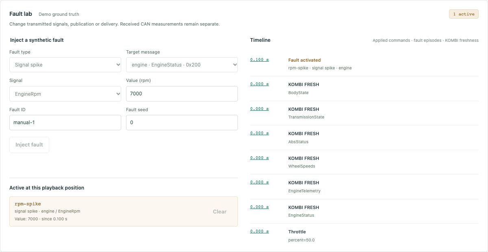
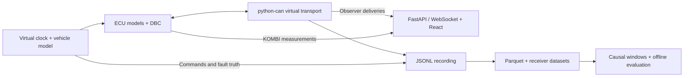

# AutoCAN Studio

AutoCAN Studio is a local lab for simulating Controller Area Network (CAN) traffic, injecting faults, and evaluating anomaly detectors offline.

Repeat a vehicle-network failure under controlled conditions, inspect what each receiver could observe, and compare detectors against known fault intervals. DemoCar uses synthetic physics and original DBC profiles for experimentation without vehicle hardware. Real-vehicle diagnostics are outside its scope.

[](docs/images/m7-studio-acceptance.png)

*Fault lab during playback of a synthetic RPM spike. The linked full dashboard capture shows a separate Engine ECU outage. [v0.1.0 browser demo](docs/images/m4-demo.webm)*

## What you can do

| Surface | Capabilities |
| --- | --- |
| **Dashboard** | Drive a simulated vehicle, inspect decoded CAN frames and per-message freshness, inject faults or run built-in scenarios, and save, seek through, or recompute a recording. |
| **Headless CLI** | Run seeded JSON scenarios on an integer virtual clock. Record, verify, replay, and rerun them. Exchange traces through Parquet and generate collections across six driving modes with separate fault labels. |
| **Offline research** | Build causal feature windows, compare three fixed rules with two scikit-learn models, and evaluate saved scores for window accuracy, fault detection, false alarms, uncertainty, and inference performance. |

Five electronic control units (ECUs) exchange messages in the network profile. They represent the engine, ABS/DSC, transmission, body, and instrument cluster (KOMBI). Eight DBC-defined messages travel through a virtual bus with receiver-specific delivery. Faults can suppress publication, drop or delay messages, change their rate, or perturb encoded signals.

The default branch includes unreleased features. The only published release, v0.1.0, ships the original engine-to-cluster demo. [Release notes](https://github.com/cryptoadya/autocan-studio/releases/tag/v0.1.0) · [Unreleased changes](CHANGELOG.md#unreleased)

## Architecture



The simulator owns physics and scheduling. ECU models receive narrow sensor or actuator interfaces and their own CAN deliveries. KOMBI derives measurements and freshness from its received CAN stream. Recording keeps applied commands and fault truth separate from observations. Playback reads saved events, while rerun executes the simulation again from the recorded configuration and commands.

## Machine learning and evaluation

The offline pipeline compares heartbeat timeout, RPM derivative, and wheel-speed disagreement rules with an **Isolation Forest** fitted on normal training windows and a supervised **Random Forest**. It splits by whole run, fits preprocessing on training data, and freezes model thresholds on validation before scoring held-out data.

The following measurements come from the checked-in frozen synthetic evaluation. Precision, recall, and F1 are window metrics. Detection latency is the median virtual time from fault onset to a matched alert, measured only for detected episodes.

| Evaluation set | Detector | Precision | Recall | F1 | Events detected | Median detection latency |
| --- | --- | ---: | ---: | ---: | ---: | ---: |
| In-distribution test | Random Forest | 1.000 | 0.967 | 0.983 | 3/3 | 10 ms |
| In-distribution test | Isolation Forest | 0.316 | 0.400 | 0.353 | 2/3 | 0 ms |
| Held-out fault types | Random Forest | 0.961 | 0.851 | 0.902 | 6/6 | 60 ms |
| Held-out fault types | Isolation Forest | 0.264 | 0.161 | 0.200 | 3/6 | 40 ms |

On six unfamiliar normal runs (45.6 seconds total), Random Forest produced **10 false-alarm episodes**, Isolation Forest **15**, and each fixed rule **zero**. The best rule by test-window F1 scored **0.500** and detected **1/3** test episodes. A separate Apple M1 benchmark measured **3.64 ms p95** for single-window Random Forest preprocessing and scoring.

The small synthetic fixture limits the conclusions, and the false alarms show sensitivity to unfamiliar normal driving. The repository includes the reports and manifests. Exact replay requires original local datasets and saved model artifacts outside Git. [Evaluation methodology, results, and provenance](docs/ML_EVALUATION.md)

## Quick start

Install **Python 3.12**, **uv 0.13.6**, and **Node.js 22.12+ with npm**.

```sh
git clone https://github.com/cryptoadya/autocan-studio.git
cd autocan-studio
uv run --locked autocan studio
```

Open [http://127.0.0.1:8000](http://127.0.0.1:8000). The launcher builds the React dashboard and serves it with FastAPI from the same loopback origin. No API keys or CAN hardware are required.

Choose **ABS missing frames** under **Fault scenarios**, then **Run scenario**. Load the saved run and seek through the outage to see wheel-speed freshness change while engine RPM remains fresh. **Deterministic rerun** recomputes the run and checks its canonical events and final state.

Run the Python tests from the repository root.

```sh
uv run --locked pytest
```

See the [getting started guide](docs/GETTING_STARTED.md) for headless commands and frontend tests.

## Limitations

- DemoCar uses synthetic classic CAN and simplified straight-line vehicle dynamics. The transport omits wire arbitration and physical bus behavior.
- Studio serves one local simulation at a time, with bounded recordings and display buffers. Virtual-time determinism provides no wall-clock real-time guarantee.
- Detector training and scoring are offline. The evaluation provides no evidence of reliability on real vehicle CAN traffic.

## Documentation

- [Getting started](docs/GETTING_STARTED.md) — dashboard, headless recording, and tests
- [Architecture](docs/ARCHITECTURE.md) — scheduling, ECU boundaries, and the local API
- [Simulation and faults](docs/SIMULATION.md) — profiles, scenarios, and fault semantics
- [Trace and dataset formats](docs/DATA_FORMATS.md) — JSONL, Parquet, observer data, and generated collections
- [ML evaluation](docs/ML_EVALUATION.md) — methods, measured results, and reproducibility

## Roadmap

Potential next steps include live scoring from the same causal feature pipeline, broader synthetic evaluation across normal driving regimes, and a packaged dashboard distribution. See the [roadmap](docs/ROADMAP.md) for scope and status.

[Changelog](CHANGELOG.md) · [MIT license](LICENSE)
