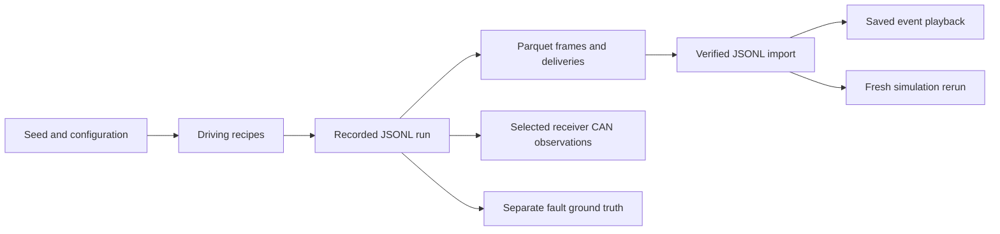
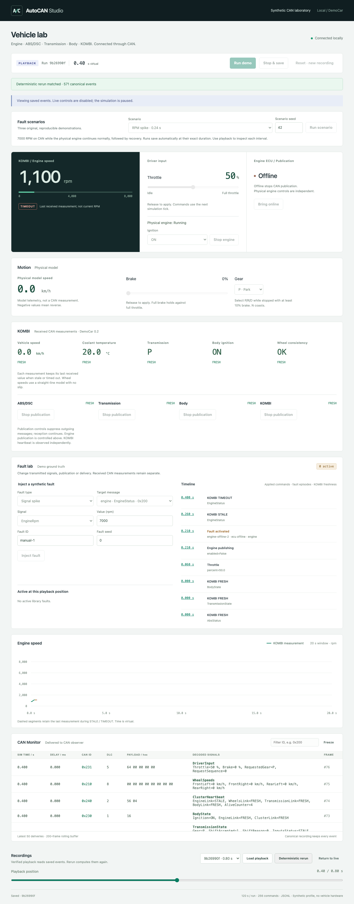

# M7 acceptance: traces and Dataset Factory

Local acceptance completed on 2026-10-31. This report covers the M7 storage and
generation contract and regression checks for the existing V1 application.
Release tags, GitHub publication and M8 features/ML are separate actions.



## Criteria and evidence

| M7 criterion | Result and evidence |
| --- | --- |
| Normalized frames and per-receiver deliveries | Explicit, nonnullable Parquet schemas retain raw payloads, frame references and canonical sequence/time. Verified by `tests/test_parquet_traces.py` and 24 full collection round trips. |
| Streaming export/import, bounded volume | At most 256 rows per Parquet group, bounded receiver lookup, metadata/decoded-size limits, 16 MiB per output, 1–300 runs and an explicit collection quota. Tests cover quota failures and removal of staging. |
| Physical checksums and independent semantic hashes | Import and collection verification read the actual tables, recompute row hashes and compare every derived event/observation/label with its verified source. Rehashing physical bytes cannot hide changed content. |
| Reproducible driving modes and fault runs | Six normal modes have physical behavior checks at 8 s and 30 s; all eight library fault types record and rerun. The default collection contains four trips per mode and six fault episodes. |
| Separate ground truth and observer inputs | Input columns contain only delivered wire fields and receipt time. Commands, physical state, creation time, seeds, scenarios and fault labels remain outside that table. Source projection checks include delayed/dropped/pending delivery cases. |
| Verifiable provenance | The root inventory binds all nested artifacts; source manifests retain DBC/config/core/package hashes and versions. Saved scenario commands, simulation seed, duration, profile and transport settings are checked against the recorded run. |
| Generate → save → reload → playback | A fresh default 24-run series was saved, verified, imported from Parquet and played back. All 203,527 canonical events retained their source semantic hashes. |
| Separate fresh rerun | Every one of those 24 imported runs was recomputed; canonical event counts/hashes and final state matched. Playback/verification do not execute physics. |
| Historical JSONL support | The unchanged v0.1 fixture survives Parquet exchange and playback. An incompatible historical core still rejects rerun explicitly. Supported schemas/profiles remain documented in `PARQUET.md`. |
| Safe output publication | Existing destinations are rejected. Successful conversion is staged privately and publishes the complete manifest last; failed quota/conversion produces no complete collection and does not overwrite existing runs. |
| Optional metadata index | SQLite is unnecessary for the current bounded CLI manifest/inventory; it is not a frame store or an M7 blocker. |

## Defects corrected during acceptance

The initial collection verifier trusted the declared semantic hashes of derived
tables after checking only the outer physical inventory. It also checked the
saved recipe's hash without comparing that recipe to the actual applied command
log. Three new regression cases reproduced both failures before the fixes.

`verify-dataset` now validates nested schemas, sizes, hashes and source
equivalence, including fault labels and the saved DBC. It compares each applied
`ScenarioCommand` with the source recipe and checks profile/transport parameters.
Derived tables are consumed with bounded streaming iterators; no fresh physics
run is hidden inside verification. Independent follow-up review found no
remaining M7 blocker in these changes.

## Executed checks

| Command/check | Result |
| --- | --- |
| `uv run --locked pytest` | 327 passed |
| `uv run --locked ruff check .` | Passed |
| `uv run --locked ruff format --check .` | Passed |
| `uv run --locked mypy` | Passed |
| `uv build --no-sources` | Source distribution and wheel built |
| `npm --prefix frontend run typecheck` | Passed |
| `npm --prefix frontend test` | 23 passed |
| `npm --prefix frontend run build` | Passed |
| `npm --prefix frontend run test:e2e` | 8 Chromium tests passed |
| Isolated built-wheel generator, verification and rerun | Passed on Python 3.12, outside the source checkout |

The browser checks exercised physical ignition/Start/Stop, motion/interlocks,
all five ECU, three fault scenarios, manual faults/timeline, reconnect, saved
playback, fresh rerun and mobile layout against the real local API and built UI.
Chromium's own sandbox remained enabled; execution used the normal macOS host
outside the restrictive Codex sandbox. The first attempt lacked the required
Chromium v1248 binary; installing that exact browser resolved the startup failure.

The initial isolated wheel attempt selected the host's Python 3.11 and was
correctly rejected by the package's Python >=3.12 requirement. Explicitly choosing
Python 3.12 made generation, verification and rerun pass in an isolated wheel
environment, with no imports from the checkout. A macOS `/usr/bin/time -l` wrapper
also returned an error when the Codex sandbox denied its `sysctl` query; the
complete check was repeated successfully using Python timing/resource reporting.



## Reproduce the M7 flow

Use new output names; commands intentionally refuse overwriting existing runs.

```sh
uv run --locked autocan generate --output data/datasets/m7-check --seed 42
uv run --locked autocan verify-dataset data/datasets/m7-check
uv run --locked autocan trace-import data/datasets/m7-check/runs/0000/parquet --output data/runs/m7-restored
uv run --locked autocan playback data/runs/m7-restored
uv run --locked autocan rerun data/runs/m7-restored
```

The actual final collection stays ignored under
`data/datasets/m7-final-acceptance-seed42/`: 24 runs, six fault episodes, 384
artifacts, 68,080,322 bytes including the manifest. Its logical SHA256 is
`dd0ac697373b588b9f2a7fc0ed4f898ca12429967a2a7790abe711e39088c207`.
It matches the previous implementation sample's logical hash despite new run
identities and physical metadata bytes. All 24 runs were separately imported,
played back and recomputed; this is stronger than checking only the first run
in the example commands. Generated collections and browser videos/traces stay
local; only the small screenshot is tracked.

One local pass over the already generated collection (verification plus all
imports/playbacks/reruns) took 25.26 seconds with peak process RSS 66,240,512 bytes
as reported by Python's `resource` module. This is a single measured sample,
excluding generation, rather than a performance budget or hardware guarantee.

The storage formats remain version 1, both DemoCar profiles remain supported,
and the development package version remains 0.1.0 until release preparation.
This acceptance does not add API/UI generation, temperature/load randomization,
feature windows, frame/window anomaly classes, dataset splits, baselines or ML.
Remote CI and release publication were not run or claimed.
