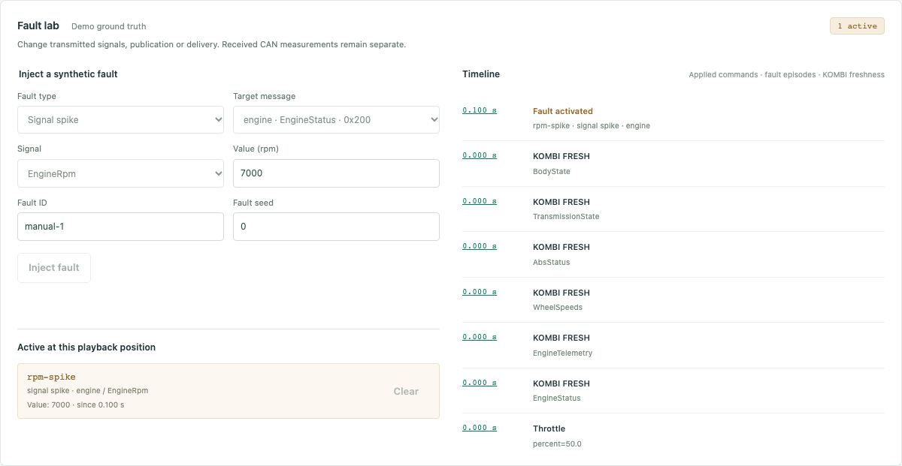

# Simulation and faults

The dashboard selects `democar-network`, with five ECUs and eight CAN
messages. Headless commands also support the original `democar` profile.
That profile remains the default for `demo`, `shell`, and API requests
that omit a profile. See the [profile and timing contracts](DATA_CONTRACTS.md).

The network profile supports eight fault types through strict JSON scenarios,
the CLI, and the local API and dashboard. Physical engine controls, manual ECU
publication controls, and fault injections are recorded as distinct commands.
Playback restores a bounded fault timeline from saved events. For offline
detection against fault ground truth, see [ML evaluation](ML_EVALUATION.md).

## Run three synthetic demonstrations

```sh
uv run --locked autocan run scenarios/abs_missing_frames.json --output data/abs-missing
uv run --locked autocan run scenarios/rpm_spike.json --output data/rpm-spike
uv run --locked autocan run scenarios/timing_jitter.json --output data/timing-jitter
uv run --locked autocan playback data/rpm-spike
uv run --locked autocan rerun data/rpm-spike
```

Each output directory must be new. The existing 16 MiB recording quota applies.
Playback verifies the saved artifacts and displays their merged canonical events;
rerun uses the manifest and applied commands without the original scenario file.

- **ABS missing frames:** the car selects D and accelerates. ABS publication
  stops during `[200, 500)` ms while physics and other ECU continue. The last
  WheelSpeeds delivery is at 180 ms; KOMBI becomes STALE at 240 ms, TIMEOUT at
  380 ms and FRESH at 500 ms. This tests received-data availability.
- **RPM spike:** during `[100, 200)` ms EngineStatus carries 7000 RPM, within
  the DBC's 0–8000 range. The physical RPM continues normally; after clear,
  EngineStatus returns to its measured value.
- **Timing jitter:** EngineStatus uses a 60 ms publication interval and an
  independent uniform integer delivery delay of 0–60 ms during `[100, 300)` ms.
  Frame creation times and payloads remain intact. Clearing preserves the next
  publication already scheduled at 340 ms and deliveries already in flight.

## Dashboard and API

Launch `uv run --locked autocan studio` and open the local dashboard. In **Fault
scenarios**, choose a demonstration and seed, then **Run scenario**. A scenario
creates a new recorded network session, starts it and saves automatically at its
exact duration. Stop and save an existing live run before selecting another.
These short demonstrations are intended for close inspection in playback:

1. Select the saved recording and choose **Load playback**.
2. Seek to 0.40 s for ABS TIMEOUT, 0.15 s for the RPM spike, or 0.15 s for jitter.
3. The active-fault cards and timeline describe only events applied by that
   position. In the jitter run, filter CAN ID `0x200`: **DELAY / ms** shows the
   synthetic delivery time minus frame creation time. At 0.15 s the most recent
   observer EngineStatus delay is 24.942 ms for the default seeds.
4. Click a timeline timestamp to seek directly to that event. **Deterministic
   rerun** recomputes and compares the saved stream and final state.

For manual injection, **Run demo**, optionally pause, then choose the fault type,
target message (or all messages of an ECU for offline), signal, parameters, ID and
fault seed in **Fault lab**. Value bounds and resolution come from the DBC.
Delays and periods are entered in milliseconds and sent as integer nanoseconds.
A blank held value captures the first publication. Give simultaneous faults
distinct IDs; the form starts with `manual-1`. **Inject fault** and each active
card's **Clear** action queue canonical commands. While paused, the active list
changes only after resuming. Duplicate/unknown IDs appear as rejected commands
in the timeline; invalid parameters produce an explicit validation error.

Playback disables scenario creation, injection and clear. Reset saves the old
run and prepares a new recording, preserving the selected scenario and run seed.
Starting an ordinary demo after a completed scenario creates an ordinary network
run. Stopping a scenario early saves only its applied commands; rerun uses that
actual end time rather than running the unused remainder of the preset.

| Endpoint | Behavior |
| --- | --- |
| `GET /api/scenarios` | Three built-in IDs, descriptions, profile, duration, default seed and source SHA-256. |
| `GET /api/faults` | Eight fault types and parameter metadata; DBC-derived message publishers, analog signals, ranges, resolution and units. |
| `POST /api/simulations` with `scenario_id`, optional `seed` | Create the selected scenario paused; infer its network profile. An explicitly conflicting profile is rejected. Then POST its `/start` action. |
| `POST /api/simulations/{id}/faults` with `{"fault": {...}}` | Validate the library specification and reserve one command; return `applied_at_ns`. |
| `POST /api/simulations/{id}/faults/{fault_id}/clear` | Reserve a clear command and return its canonical time. |
| Existing `POST .../faults` with `{"offline": true, "ecu_id": "abs"}` | Control the manual publication gate. |

Requests retain strict types, unknown-field rejection, the 4096-byte body limit,
same-origin/loopback access and the shared 256-command quota. Scenario commands
reserve their share at creation. Unsupported profiles and invalid definitions
cannot consume a manual-command slot. Fault failures during simulation stop the
session with a failed recording; they are not silently converted into valid data.

Snapshots, WS batches and playback add `scenario`, `active_faults`, `timeline`
and `timeline_truncated`. The latest 100 relevant events include applied driver
commands, activation/clear, rejected fault commands and KOMBI freshness changes.
Older events are explicitly counted as omitted; the canonical recording remains
complete. The up-to-32 active library faults are retained independently of this
window. Manual offline markers appear in the timeline, while their publication gates
remain controlled by the existing buttons. Ground truth is labelled separately
from received CAN measurements and is not an input to any detector.

Every WS message replaces these bounded projections; reconnect starts with a
complete snapshot. Network frames are streamed by observer `display_seq`, not
publication `frame_id`, so a delayed lower-ID frame remains visible. Playback
rebuilds projections from saved canonical events, including CLI-created runs,
and never reads future events or reconstructs fault intervals from current UI
form values.

The optional `scenario` manifest metadata records ID, name/description, profile,
effective seed, declared duration and original JSON checksum. It does not replace
the applied log or the actual recorded end time. Historical manifests without it
remain supported. The wheel includes the exact three scenario files from
`scenarios/`; an editable checkout uses those originals without a second copy.

## Schema and parameters

Scenario schema version 1 retains its existing envelope, duration, seed, transport
and driver commands. Two commands are added; their times must align to the 10 ms
input grid and lie within the run:

```json
{"at_ns": 100000000, "kind": "inject_fault", "fault": {
  "fault_id": "rpm-spike", "type": "signal_spike", "target_ecu": "engine",
  "target_message_id": 512, "signal": "EngineRpm", "parameters": {"value": 7000}, "seed": 0
}}
```

```json
{"at_ns": 200000000, "kind": "clear_fault", "fault_id": "rpm-spike"}
```

`fault_id` contains 1–64 ASCII letters, digits, `-`, `_` or `:`. `seed` is an
optional nonnegative integer (default 0); targets are checked against the network
DBC and its publisher. `parameters` is required. Unknown fields, booleans in
numeric fields, nonfinite numbers and invalid signal/message pairs are rejected.
No expressions or executable imports are accepted.

| Type | Parameters | Effect |
| --- | --- | --- |
| `ecu_offline` | `{}` | Suppress publication of the target message, or all of the target ECU's messages when `target_message_id` is `null`. |
| `message_drop` | `probability` in [0, 1] | Independent Bernoulli loss per subscribed receiver, after publication. |
| `message_delay` | integer `min_ns`, `max_ns`, with 0 ≤ min ≤ max ≤ 1 s | Uniform inclusive delay per receiver, added to the configured base delay. Equal bounds give a fixed delay. |
| `signal_spike` | `value` | Replace one analog signal before strict DBC encoding. |
| `signal_stuck` | optional `value` | Hold that value, or capture the signal at its first publication after activation. |
| `signal_bias` | `offset`, optional `rate_per_second` | Add offset + rate × virtual elapsed seconds from activation. Each parameter is finite and in [-10000, 10000]. |
| `message_frequency_anomaly` | integer `period_ns`, 10 ms–5 s, aligned to 10 ms | Override the interval chosen at the next publication callback. |
| `cross_signal_inconsistency` | `offset` in [-10000, 10000] | Offset one WheelSpeeds signal, creating a residual against the other wheels and model speed. |

The signal types require `signal` and a non-null message ID. Supported analog
signals are EngineRpm, Throttle, Brake, CoolantTemperature, FrontLeft, FrontRight,
RearLeft, RearRight, BrakeObserved, ThrottleObserved and EngineRpmObserved, only
where declared in the target DBC message. Enum, link, request-sequence and alive
counter fields are excluded. Other fault types do not accept a signal.

Explicit spike/stuck values must be exactly representable in the DBC. Bias ramps
use the encoder's normal nearest-step quantization. Every intermediate transformed
value must remain in the declared DBC range; otherwise simulation fails explicitly
and a recording is marked failed. Values are never clipped or wrapped. Synthetic
measurement faults do not change VehicleModel or grant receivers hidden inputs.
Network CAN feedback can affect Transmission's gear decisions as described in the
the base DBC contract. ABS's own consistency flag remains its sensor-derived report; the
cross-signal fault changes the transmitted wheel measurement, not that report.

## Simultaneous faults, timing and clear

- Input commands and fault switches apply in canonical input order before
  physics/publication at the same virtual time. Inject then clear at the same
  time leaves no effect on publication. Reversing the commands activates it.
- Signal transformations compose in activation order. Replacements override the
  value at their position; biases add to it. A captured stuck value persists until
  that fault is cleared. Clear removes only the identified transformation.
- Offline effects combine with OR. Existing manual `offline`/`online` switches
  are independent gates: `online` cannot clear a library fault, and clearing a
  library fault cannot reopen a manual gate. Publication flags in state describe
  those manual gates; `active_fault_count` counts library faults only.
- Multiple drop faults combine with OR; all matching fault streams advance even
  when another has already dropped the delivery. Delays add. The most recently
  activated frequency override wins; clearing it reveals an earlier override.
- Changing or clearing a period does not move the callback already scheduled.
  Publication cadence continues through offline intervals. Clearing delay/drop
  or going offline does not cancel or rewrite already scheduled deliveries.
  Jitter may reorder frames; each callback delivers its exact immutable frame.
- Each fault has its own `Random` stream, seeded by SHA-256 over the versioned
  namespace, run seed, fault seed and ID. It shares no RNG with base transport,
  physics, scenarios or other faults. Receiver iteration follows the profile.
- At most 32 library faults may be active. Duplicate active IDs, quota overflow
  and clearing unknown IDs produce `InputApplied` with `accepted: false` and no
  fault marker. They do not stop simulation. IDs may be reused after clearing;
  reactivation starts a new episode and resets its RNG/capture. Reset clears all
  faults, counters and pending deliveries and reseeds the streams.
- There are at most 256 pending deliveries per receiver. Overflow is an explicit
  error, including when large base delays combine with injected delays.

## Manual commands and artifacts

Save the `fault` object from the example as `spike.json`, then run:

```sh
uv run --locked autocan shell --profile democar-network --seed 42 --record data/manual-fault
```

Enter `inject spike.json`, `run 100`, `clear rpm-spike`, `run 20`, then `quit`.
`run` takes milliseconds. Specification files are limited to 4096 bytes and copied
into the applied log, so later edits/deletion do not affect rerun. Invalid manual
commands print an error and leave the session available. Commands queued while
paused apply when virtual time resumes. Only applied commands are recorded; use
`run 0` to execute initial queued inputs. An empty recording cannot be finalized.
Reset during a recording is rejected: exit and start a new recording instead.

`commands.jsonl` stores `inject_fault` with a canonical `fault_json` string and
`clear_fault` with its ID, application time/order and acceptance result. Fault
activation/clear events in `faults.jsonl` include the same specification, targets,
seed and episode boundaries. An uncleared episode remains active through the run
end; saving does not synthesize a clear command. `events.jsonl` holds observations
without these labels. Existing publication-offline commands/markers stay supported.

New runs use core `m6-faults-1`. Manifests include the fault algorithm/RNG version
and hash `faults.py` with the other owning core sources. Historical JSONL playback
remains supported, including the v0.1 fixture; rerun requires the exact core hash,
profile and runtime versions recorded by that run.

Golden observations in `tests/fixtures/m6_faults_golden.json` cover availability
deadlines, raw EngineStatus payloads, publication timing and seeded observer
delivery timing for these scenarios. They are compact trace projections rather
than full run manifests; integration tests additionally record, verify and rerun
each demonstration through the actual CLI.


