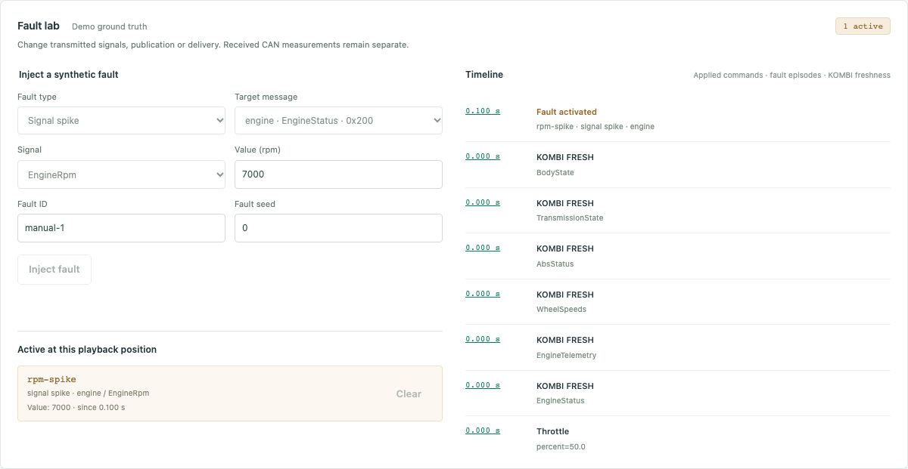

# Fault library verification

## Local M6 verification — 2026-10-31

- `uv run --locked ruff check .`, `uv run --locked ruff format --check .`,
  `uv run --locked mypy`, `uv run --locked pytest -q`: passed, 278 Python tests.
- `uv build --no-sources`: source distribution and wheel built successfully.
- `npm --prefix frontend run typecheck`, `npm --prefix frontend test`,
  `npm --prefix frontend run build`: passed, 23 frontend tests.
- `npm --prefix frontend run test:e2e`: eight Chromium tests passed against the
  production build and actual API/core. Three cover scenario effects in playback
  and matching rerun; one covers paused manual injection, reload, clear, saved
  commands and reset; four retain the M5/vertical-slice acceptance.
- Desktop 1280×900 and mobile 390×844 rendering were checked, with page identity,
  meaningful content, interaction assertions, no application console errors or
  framework overlay, screenshots and no horizontal document overflow. The Browser
  plugin was not available; the repository's Playwright workflow was used outside
  the restrictive macOS sandbox with Chromium's own sandbox enabled.
- A wheel installed in an isolated Python 3.12 environment under `/private/tmp`
  loaded all three packaged scenarios without the source checkout.

The browser pass caught duplicate React keys for the new panel and CAN Monitor;
a regression test now checks that run replacement leaves one fault panel. Runtime
DBC failures stop recording, while rejected commands on an already saved session
preserve its saved status. All local M6 acceptance criteria are covered; remote
CI, publication, other browsers and M7 are not claimed.

